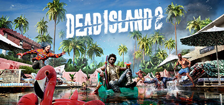

**Dead Island is the zombie survival RPG set on the tropical resort island of Banoi, where four survivors use melee weapons, crafting, and vehicle combat to navigate an open world overrun by the undead. Features weapon degradation and co-op for up to four players.**

---

## 📖 About

Dead Island is the zombie survival RPG set on the tropical resort island of Banoi, where four survivors use melee weapons, crafting, and vehicle combat to navigate an open world overrun by the undead. Features weapon degradation and co-op for up to four players.

## ⚠️ Problems Without Trainer

| Problem | Status |
|---------|--------|
| **Weapon Degradation** — Weapons break constantly requiring perpetual repair resource management | ✅ Solved |
| **Quest Tracking** — Quest objectives often provide minimal direction across large maps | ✅ Solved |
| **Enemy Scaling** — Enemies scale with player level but don't always feel rewarding to fight | ✅ Solved |
| **Technical Issues** — Older title has various bugs and performance inconsistencies | ✅ Solved |

## ✅ Solution

The **Dead Island Trainer** solves all these issues by giving you complete control over the game.

## 🎯 Full Feature List

- Unlimited Resources
- God Mode / Invincibility
- Instant Skill Cooldown
- One-Hit Kill
- Freeze Game Timer
- Unlock All Items & Achievements
- Custom Speed Multiplier
- Save State Anywhere

## 🚀 Quick Start

1. **Disable Windows Defender** temporarily (trainer may trigger false positive)
2. Download the trainer from the button above
3. Launch Dead Island
4. Run the trainer as Administrator
5. Activate desired cheats with hotkeys

## 💎 Free vs Paid

| Feature | Free | Pro |
|---------|------|-----|
| Basic God Mode | ✅ | ✅ |
| Unlimited Resources | ✅ | ✅ |
| All Advanced Cheats | ❌ | ✅ |
| Auto-Updates | ❌ | ✅ |
| Priority Support | ❌ | ✅ |

## 💻 Requirements

- Windows 10/11 (64-bit)
- Dead Island (any version)
- .NET Framework 4.8+
- DirectX 11+

## 🍎 macOS

macOS users can use our alternative tool:

## ⚖️ Legal

This trainer is for educational and single-player use only. Use responsibly.

---

